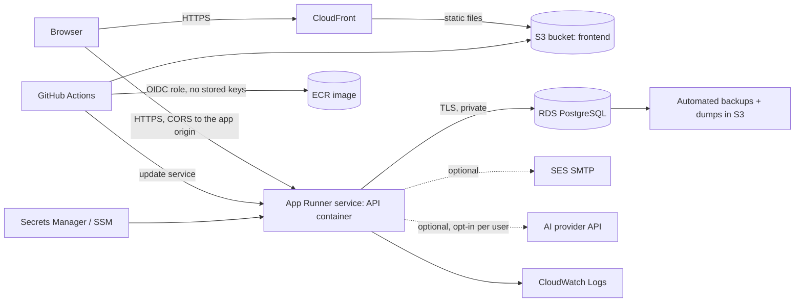

# FinTrack - deployment architecture, options and costs

**Status: NOT deployed.** Everything below is a plan plus ready-to-use artifacts (Dockerfile, CI/CD workflows, backup scripts). Nothing has been provisioned in AWS, no domain has been bought, and
no live URL exists. Pricing facts were checked on 2026-11-16 from the sources linked at the end; **re-check them on the AWS pricing pages before you provision anything.**

## 1. What the application actually needs (audit of the real project)

| Part | Reality in this repository | Consequence for hosting |
|---|---|---|
| Frontend | Static files: HTML + native ES modules + CSS + a built `dist/` (Tailwind CSS, Chart.js). No server rendering. Hash routing. | Any static host + CDN. API address is set at deploy time through `runtime-config.js`. |
| Backend | Node 20, Express 4, **long-running process**. | Needs a host that keeps a process alive (not Lambda-style request-only hosting). |
| Database | **PostgreSQL** (Prisma 5, 11 migrations), local dev uses PG 17. | Managed PostgreSQL (RDS) or PostgreSQL on a VM. Migrations via `prisma migrate deploy`. |
| Background jobs | An **in-process scheduler** (`recurringScheduler.js`): recurring transactions, subscription renewals, notification reminders, every 15 minutes + once at start. Idempotent by database constraints, so two instances cannot double-create. | The API must run continuously (no scale-to-zero) and the scheduler must be running. It does **not** depend on a browser being open. Health endpoint `/api/health/ready` reports the scheduler. |
| Files | PDF/CSV/Excel are generated **in memory** per request; uploads are read from JSON bodies (<= 6 MB). Nothing is stored on disk. | No S3/EFS needed for the application. S3 is only used for the static site and (recommended) database backups. |
| E-mail | Optional SMTP (`SMTP_*`). | Needs an SMTP provider (e.g. Amazon SES). Off unless configured. |
| AI | Optional external model (`ANTHROPIC_API_KEY`), per-user opt-in. | Outbound HTTPS only. Secret in the platform's secret store. |
| Secrets | `JWT_SECRET`, `DATABASE_URL`, optional SMTP/AI keys. The server **refuses to start in production** with a weak secret or open CORS. | Secrets Manager / SSM Parameter Store, injected as environment variables. |
| CI/CD | Previously none. Now `.github/workflows/ci.yml` and `deploy.yml`. | See `OPERATIONS.md`. |

## 2. Recommended architecture (for a portfolio / AWS-learning project)

| Layer | Choice | Why | Alternatives considered |
|---|---|---|---|
| Frontend | **S3 + CloudFront** | Cheapest and simplest for static files; HTTPS, caching, security headers via a response-headers policy. | Amplify Hosting (nicer UX, similar cost, less to learn). |
| API | **AWS App Runner** from an ECR image | HTTPS and a public URL out of the box, health checks, rolling deploys with automatic rollback, no servers to patch, runs continuously (the scheduler keeps working). | ECS/Fargate (more control and learning, more setup, similar cost, needs an ALB for HTTPS = +$16/month); EC2 or Lightsail with Docker (cheapest, but you patch it and run TLS yourself). |
| Database | **RDS PostgreSQL** `db.t4g.micro`, Single-AZ, gp3 20 GB, automated backups 7 days, **not publicly accessible** | Managed backups/patching, point-in-time recovery. | PostgreSQL in a container on the same VM (cheapest, backups are your job). |
| Network | App Runner VPC connector -> private subnets -> RDS security group that allows only the connector | The database has no public address. | - |
| Secrets | **SSM Parameter Store (SecureString)**: free standard tier | Secrets Manager costs $0.40/secret/month; Parameter Store is enough here. | Secrets Manager if you want automatic rotation. |
| Observability | CloudWatch Logs + alarms | stdout JSON logs are collected automatically. | - |
| DNS/TLS | Route 53 + ACM certificates **only if you have a domain** | Not required: App Runner and CloudFront give HTTPS URLs without a domain. | - |
| Environments | `staging` and `production` as **separate** App Runner services, RDS instances (or databases), buckets and GitHub Environments. `development` stays on your machine. | Tests and experiments can never reach production data. | A cheaper variant: one RDS instance with two databases (`fintrack_staging`, `fintrack`) with different users. |

**Two things the architecture forces, both already handled in code:**
1. Behind CloudFront/App Runner the client address comes from `X-Forwarded-For`. Set `TRUST_PROXY=1`, otherwise every user shares one IP and the login rate limiter blocks everybody (the setting is tested).
2. The frontend and API are on different origins, so the API needs an exact CORS allow-list: `CLIENT_URL=https://<your CloudFront domain>` (comma separate staging/production).

**Run exactly ONE API instance** (App Runner min 1 / max 1) for now. The scheduler is safe with several (database constraints stop duplicates) but wasteful, and the in-memory rate limiters are per instance.

## 3. Cost overview

Estimates for a **lightly used** portfolio deployment in a US region, one environment. They are estimates from published prices, **not an invoice**; actual cost depends on region, usage and your account's credits.

| Item | Estimate / month | Basis |
|---|---|---|
| App Runner, 1 provisioned instance (1 vCPU / 2 GB min config differs; memory is billed while idle) | about **$5-15** | $0.007 per GB-hour provisioned memory (about $5.11 per GB-month); active time adds $0.064 per vCPU-hour + memory. A per-service fee of about $1 is mentioned by third parties and is **unconfirmed**. |
| RDS PostgreSQL `db.t4g.micro` Single-AZ | about **$12** + storage about $2-3 | about $0.016/hour on demand (third-party breakdown), gp3 storage and backup storage extra. |
| S3 + CloudFront | **under $1** for a few users | CloudFront has an always-free monthly allowance; S3 storage of a few MB. Verify the current allowance. |
| CloudWatch Logs | $0-2 | about $0.50 per GB ingested; JSON request logs are small. |
| SSM Parameter Store (standard) | **$0** | |
| Route 53 hosted zone + domain | $0.50 + about $10-15 per YEAR | only if you use a custom domain. |
| **Total, one environment** | **about $20-30 / month** | A second (staging) environment roughly doubles the database and App Runner lines. |

**Free tier reality (July 2025 change):** accounts created after 2025-07-15 get a **Free plan: up to $200 in credits (starting at $100, more by completing activities), valid for 6 months or until the credits run out**, then an upgrade to the Paid plan is required. The old "750 free RDS hours for 12 months" applies only to older accounts, and sources disagree on whether new accounts get dedicated RDS hours; the AWS page lists `db.t4g.micro` among free-plan-eligible instances (paid from credits). The free plan also blocks some expensive services and instance sizes. **Whether App Runner and RDS are covered by your credits must be confirmed in your own Billing console.**

**Cheapest viable alternative (about $10-13/month, more work for you):** one `t4g.small` EC2 (or Lightsail) running `docker compose` (API + PostgreSQL) behind Caddy for automatic HTTPS (needs a domain), frontend on S3 + CloudFront, nightly `db-backup.js` copied to S3. You own OS patches and backups.

**Decision needed from you before anything is provisioned:** (a) this recommended App Runner + RDS design, or (b) the cheaper single-VM design; (c) whether you have a domain; (d) budget alarm amount. See the questions at the end of the final report.

## 4. Sources checked

- AWS Free Tier overhaul (Free plan, credits, 6 months): https://aws.amazon.com/about-aws/whats-new/2025/07/aws-free-tier-credits-month-free-plan
- AWS App Runner pricing: https://aws.amazon.com/apprunner/pricing/
- Amazon RDS for PostgreSQL pricing: https://aws.amazon.com/rds/postgresql/pricing
- AWS free database page: https://aws.amazon.com/free/database/
